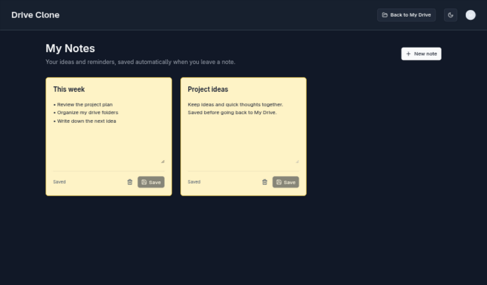

# Notes verification — October 14, 2026

Implemented `/dashboard/notes`, with a Notes button in the Drive header and a Back to My Drive button on the notes page. All sticky notes have the same yellow background and contain only a title and description. Notes save on Save, when focus leaves the card, and after an 800 ms pause while typing. Header navigation waits for pending saves. Failed saves keep the edits available for retry.

## Environment and database

Pulled the linked `memo-drive` Vercel project's **development** variables into ignored `.env.local`. No secret values are included in this report or committed files. Successfully connected to SingleStore and applied `drizzle/singlestore/0000_add_notes.sql` with Drizzle. Existing Drive tables were preserved.

## Automated tests: 11 passed

Run `pnpm test:notes` (Node with TypeScript stripping support).

| Test                                                          | Result |
| ------------------------------------------------------------- | ------ |
| All note actions reject unauthenticated users                 | Pass   |
| New notes belong to the authenticated account                 | Pass   |
| Listing notes includes the account filter in generated SQL    | Pass   |
| Owner saves persist title and description                     | Pass   |
| Cross-account update/delete and spoofed owner ID are rejected | Pass   |
| Owner deletion preserves the other account's note             | Pass   |
| Invalid IDs and oversized text fail before DB writes          | Pass   |
| Unchanged notes skip DB writes                                | Pass   |
| Saving marks both fields as saved                             | Pass   |
| Concurrent saves serialize edits; latest text wins            | Pass   |
| Failed saves preserve changes and allow retry                 | Pass   |

Server-action tests use mocked Clerk and storage, with the actual action/helper source, actual schema, Zod validation, and Drizzle SQL generation. Save-queue tests exercise the actual `createNoteSaver` implementation.

## Live SingleStore integration: 6 passed

Run explicitly with `pnpm test:notes:db`. This uses the configured database and the actual `DB_QUERIES`/`DB_MUTATIONS` implementations. It creates two random test owner IDs, then cleans up only their rows in a `finally` block.

| Test                                                 | Result |
| ---------------------------------------------------- | ------ |
| Create notes linked to separate accounts             | Pass   |
| Account-scoped listing                               | Pass   |
| Save and reload title and description                | Pass   |
| Cross-account updates leave the original note intact | Pass   |
| Cross-account deletes leave the original note intact | Pass   |
| Owner deletion preserves the other account's note    | Pass   |

All test rows were cleaned up successfully.

## Browser interaction checks: 11 passed

Used the T3 collaborative browser with the actual `NotesBoard`, dashboard layout, buttons, and Tailwind styles in an isolated preview. Clerk/router/actions were test adapters, and the preview stored its test notes in a separate SQLite database. These checks verify the UI behavior; they are **not** an authenticated Clerk-to-SingleStore end-to-end test.

| Test                                                              | Result |
| ----------------------------------------------------------------- | ------ |
| Create notes with title/description only and identical colors     | Pass   |
| Explicit Save persists both fields                                | Pass   |
| Leaving the card saves automatically                              | Pass   |
| Pausing while typing saves automatically                          | Pass   |
| Simulated failed save keeps dirty text and shows retry state      | Pass   |
| Save retries successfully after failure                           | Pass   |
| Back to My Drive waits for an outstanding save                    | Pass   |
| Drive's Notes link opens the page and stored edits reload         | Pass   |
| Mobile viewport (390 px) stacks notes without horizontal overflow | Pass   |
| Canceling delete retains the note                                 | Pass   |
| Confirming delete removes the note from the UI and test DB        | Pass   |

An initial browser selector used unsupported `exact=true` syntax. It was corrected, and the explicit Save check was rerun successfully.

## Authenticated app checks: 3 passed

After signing in through Clerk, tested the actual Next.js app on port 3000 with the Vercel development environment and SingleStore, without mocked actions or authentication.

| Test                                                                                                         | Result |
| ------------------------------------------------------------------------------------------------------------ | ------ |
| Save writes the exact title/description under the signed-in Clerk account; confirmed directly in SingleStore | Pass   |
| Leaving the note automatically writes the changed description; confirmed directly in SingleStore             | Pass   |
| Reloading the actual notes page restores the saved title/description                                         | Pass   |

The verification note created by the browser test was removed afterward; pre-existing notes were untouched.

## Other checks

- Changed TypeScript files passed ESLint without warnings.
- Prettier checks passed for the changed source, tests, config, and package manifest.
- `git diff --check` passed.
- Regenerating the SingleStore migration from its snapshot reported no schema changes.
- Source-only TypeScript validation passed.
- The initial project typecheck passed before Next generated route types. After generation it exposed an existing extra export in `purchase/success/page.tsx`. Removing the unused export fixed the route validation, and `pnpm check` (lint and project typecheck) then passed, with existing unrelated lint warnings.
- An initial lint run lacked environment variables; it was rerun successfully with validation skipped, and again through `pnpm check` after pulling Vercel variables.
- An initial changed-file lint run flagged a nullish assignment style issue in the new component. It was corrected and lint passed.
- The first production build compiled successfully but failed during page collection because Resend and Stripe keys were missing. The production build with the pulled Vercel environment passed, including `/dashboard/notes`. It ran from a temporary copy of the same source and config with the same dependencies and `.env.local`, so the running dev server was unaffected.

## Screenshot

This screenshot shows the actual feature components with test data in the isolated UI preview described above. The authenticated app passed the three live checks, but T3’s screenshot tool subsequently timed out in `automationSnapshot.capturePage` while the preview reported itself hidden. A screenshot of the authenticated page could not be captured; this image is labeled as the isolated preview rather than live account evidence.

